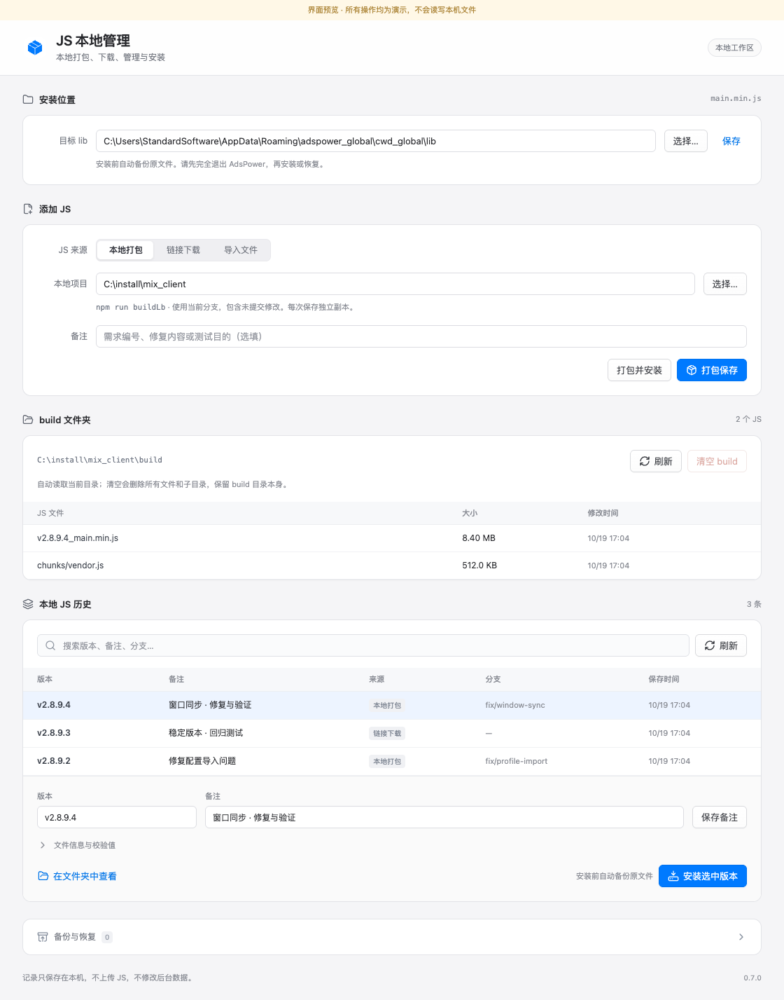
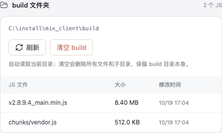

# 0.7.0 · build 目录列表与清空

Mac 和 Windows 使用同一个 HTML 组件，位于“添加 JS”与“本地 JS 历史”之间，沿用现有苹果风格间距和 Lucide 图标。目录列表显示真实 JS 相对文件名、大小与修改时间，前台约每秒读取，页面隐藏时每 5 秒读取；支持手动刷新和切换项目路径。读取不保存配置、不执行 npm、不访问后台。

“清空 build”使用原生确认框，显示实际目录，默认取消。确认后删除所选项目 build 内所有文件和子目录，保留 build 本身。打包与清空共用 `.ads-work-build.lock`，打包期间禁用清空；清空前完整检查目录，拒绝链接/重解析点、未恢复的旧构建目录，以及位于 build 内的 JS 库或安装目录。停止或失败可能已经删除部分文件，页面会重新读取实际目录。测试全部使用临时项目，没有清空用户的 mix_client/build，也没有替换实际 AdsPower 文件。

验证结果：

- Swift 完整自检通过，包含真实临时 Git/npm 打包、同名产物、失败恢复、安装备份、下载与现有模型流程；新增目录边界 25 项断言通过。
- C# 核心在 Mac 上执行 124 项断言通过，包括目录读写、外部变化、非 JS 与子目录清空、保护路径、链接及构建锁。
- Chrome：原本地界面 62 项、目录列表 12 项、动画下拉 24 项、模拟消息参数契约 7 项、服务器界面 57 项全部通过。目录检查包含自动更新、项目变化、错误恢复、文件名按纯文字显示、忙碌禁用清空与窄窗口。
- 真实 Mac WKWebView：本地 28 项、服务器 25 项通过。本地页面通过实际消息通道读取临时 build，外部新增 JS 自动出现；确认回调分别模拟用户取消和同意，并验证真实文件删除、目录保留及历史/安装恢复。
- 当前自动化 Mac 窗口被 WebKit 视为隐藏页面，动画时钟不推进。上述原生检查只对临时测试副本启用“减少动态效果”；交付的资源保留正常动画，动画由 Chrome 单独验证。原生确认框的用户选择使用注入回调；实际 NSAlert 的视觉与鼠标操作需人工复核。
- Mac Release 编译、ad hoc 签名及 ZIP 解压后签名验证通过。Windows x64 自包含程序交叉编译成功；从最终 EXE 提取 DLL，并核对其中全部 10 份页面资源，与源码及 Mac 包内对应资源逐字节一致。两端 ZIP 均解压/读取回验，随包生成 SHA-256。
- 本机无法运行 Windows WebView2，尚未验证真实 Windows 原生确认框、文件占用及系统 DPI。Windows 包含 `--web-check` 模式，后续可在实机验证；浏览器模拟消息不等于 Windows 原生执行结果。

交付路径、校验值与断言数量见 [delivery.json](delivery.json)。ZIP 和应用位于本地 `dist/`，不提交二进制到 Git。

