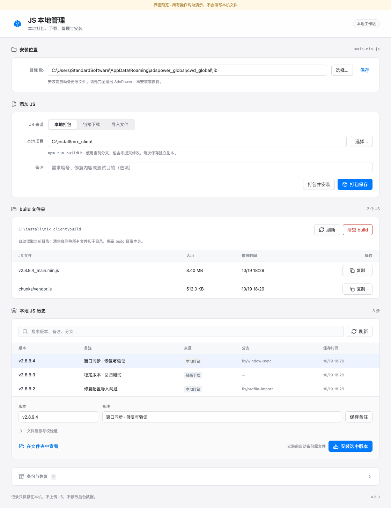
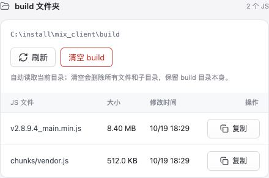

# 0.8.0 · 文件复制与交互反馈

Mac 和 Windows 共用 HTML 页面，新增三项：

- 手动刷新立即旋转，至少完成一圈，并等待实际操作结束；读取失败也会复位。自动轮询不旋转。覆盖 build、历史和 Mac 服务器分支刷新，连续点击不重复发起任务，遵循系统“减少动态效果”。
- “清空 build”与“停止”共用危险按钮样式：红色文字与边框、白底；悬停浅红底；按下深红底白字，键盘焦点也使用红色。
- build 列表每条 JS 增加“复制”，通过原生文件剪贴板复制，可粘贴到 Finder / Windows 文件夹，保留原文件名。成功后短暂显示“已复制”，按钮宽度固定；复制期间禁用重复复制、打包和清空。窄窗口保留操作按钮与表格对齐。

复制会先保存独立副本，再写入剪贴板，因此清空 build、重新打包或退出工具不会主动移除当前副本。Mac 使用 `NSPasteboard` 文件 URL；Windows 使用 FileDrop 文件列表及 Copy 操作标记，持久化到系统剪贴板。文件读取在后台进行，不通过页面传输 JS 内容，不执行脚本，不保存输入路径，不添加历史记录。

副本只接受所选项目 build 内的普通 JS，限制 100 MB，拒绝越界、链接和构建恢复目录；读取期间检查文件变化，并与打包/清空共用构建锁。Mac 缓存为 `~/Library/Caches/MixWebDeploy/copied-js`，Windows 为 `%LOCALAPPDATA%\AdsWorkJsManager\copied-js`。成功复制时清理超过七天或超出最近十份的旧副本，保留当前剪贴板引用；无关文件夹不清理。

验证结果：

- Swift 完整自检通过：原打包、独立历史、下载、备份恢复、停止、失败回滚等流程；目录边界 25 项，新增副本与缓存清理 27 项断言。
- C# 核心在 Mac 上运行 149 项断言通过，包含原 Git/npm 实际临时构建以及复制、清空后粘贴、路径边界、取消、缓存清理。
- Chrome 检查：本地页面 62 项、目录列表 12 项、复制与刷新 21 项、原有动画 24 项、模拟消息契约 7 项、服务器页面 66 项全部通过。检查了实际图标绘制、旋转与请求生命周期、自动轮询不旋转、危险按钮各颜色状态、复制成功/失败、列表更新期间反馈、按钮宽度和窄窗口。人工查看了截图。
- 真实 Mac WKWebView：本地 32 项、服务器 27 项通过。使用专用命名测试剪贴板，实际写入文件 URL，读回副本并在清空后复制到临时目标、核对 JS 内容；无效文件请求保留原剪贴板。未改用户通用剪贴板、实际 mix_client/build 或 AdsPower 文件。
- 当前自动化 Mac 窗口被 WebKit 视作隐藏页面，动画时钟不推进；原生检查仅对临时副本启用减少动态效果，生产资源保留正常动画。确认弹窗选择沿用注入回调，未在真实 Finder 中执行粘贴。动画与颜色由 Chrome 独立检查。
- Mac Release 及 ad hoc 签名验证通过。Windows x64 自包含程序交叉编译成功，最终 EXE 的主 DLL 与核心 DLL 均匹配编译结果；其全部 10 份共用资源与源码及 Mac 包逐字节一致，功能图标为同一份 Lucide 资源。
- 当前 Mac 无法运行 Windows 应用，Windows WebView2、资源管理器粘贴、Clipboard 占用和系统 DPI 仍需实机验证。两个 ZIP 均回验完整性并记录 SHA-256。

交付路径与校验值见 [delivery.json](delivery.json)。二进制保存在本机 dist，不提交到源码仓库。

